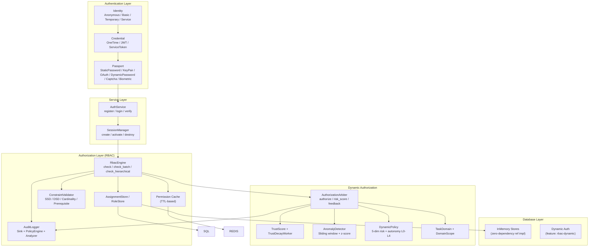
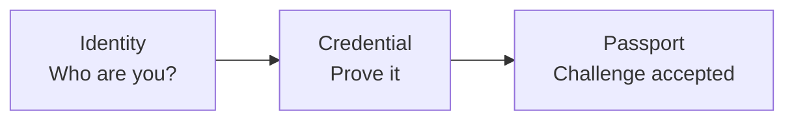
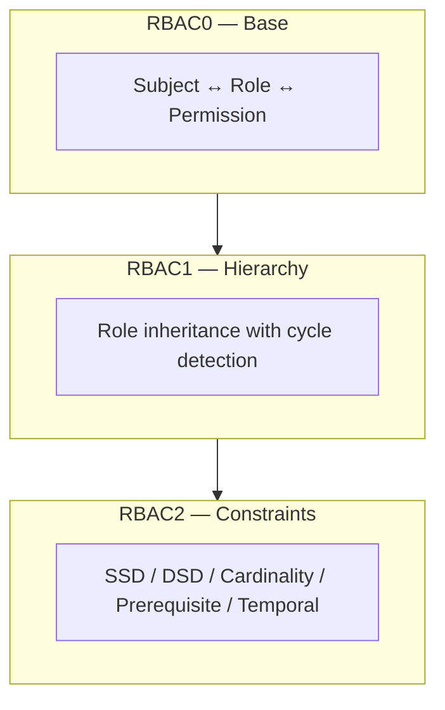
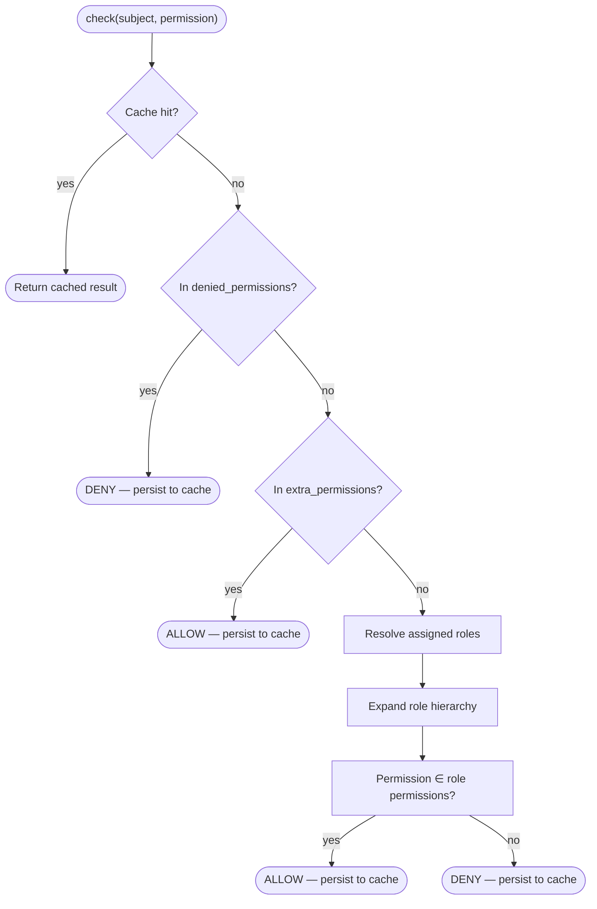
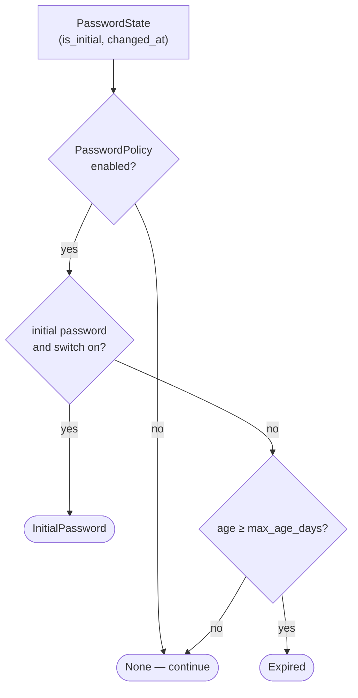
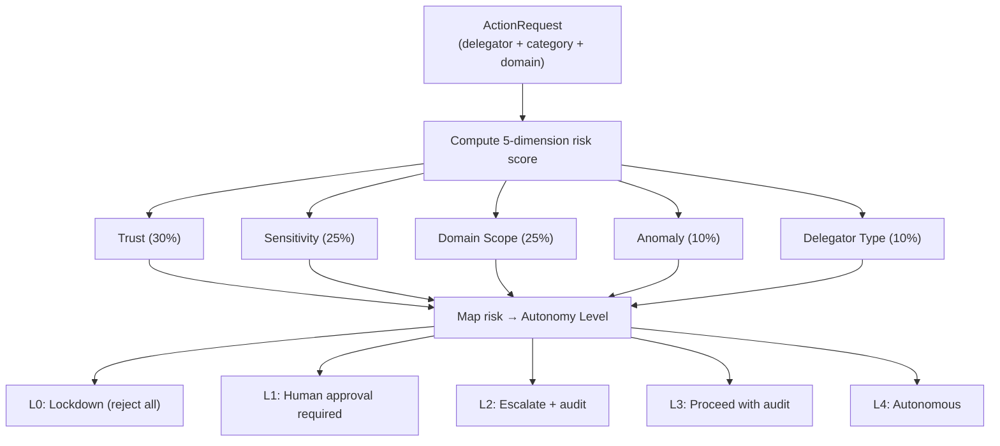

<p align="center"></p>

<h1 align="center">Kirino</h1>
<div align="center">
 <strong>
   Zero-trust authentication and authorization framework
 </strong>
</div>

<br />

<div align="center">
  <a href="https://github.com/celestia-island/kirino/actions">
    
  </a>
  <a href="https://crates.io/crates/kirino">
    
  </a>
  [](https://sysl.celestia.world)</div>

<div align="center">
  <h3>
    <a href="https://docs.rs/kirino">
      API Docs
    </a>
    <span> | </span>
    <a href="#quick-start">
      Quick Start
    </a>
    <span> | </span>
    <a href="#documentation">
      Documentation
    </a>
  </h3>
</div>

<br/>

A fully generic, trait-based authentication and authorization framework for Rust. Provides identity types, credential management, passport challenges, a complete RBAC system (RBAC0/1/2) implementing the ANSI INCITS 359-2004 standard, and a dynamic authorization layer with trust scoring, anomaly detection, and DO-178C inspired autonomy levels (L0–L4).

The name `kirino` comes from the character [Kirino](https://bluearchive.wiki/wiki/kirino) in the game [Blue Archive](https://bluearchive.jp/).

> Still in development, the API may change in the future.

## Features

- 🛡️ **Zero-Trust Architecture**: Anonymous, Basic, Temporary, and Service identity types
- 🔑 **Multi-Credential Support**: One-time tokens, JWT, service tokens, and more
- 🎫 **Passport Challenges**: Static password, key pair, OAuth, TOTP/HOTP, captcha, biometric
- 🔒 **Argon2 Password Hashing**: Secure password verification out of the box
- 🔐 **Password Policy**: Bootstrap temporary passwords, forced first-login change and max-age rotation as one kernel rule
- 🎯 **Full RBAC System**: RBAC0 (base), RBAC1 (hierarchy), RBAC2 (constraints)
- 🔄 **Role Inheritance**: Multi-level role hierarchies with cycle detection
- ⛓️ **Separation of Duty**: SSD (static) and DSD (dynamic) constraint enforcement
- 📊 **Cardinality & Prerequisite Constraints**: Limit role holders and enforce role prerequisites
- ⏱️ **Temporal Constraints**: Time-bounded role validity with automatic expiry
- 💾 **In-Memory First**: Zero-dependency reference implementations for all backends
- 🗄️ **Pluggable Storage**: Trait-based backends for SQL, Redis, and more
- 📝 **Audit Logging**: Three-layer composable audit (sink + policy engine + analyzer)
- 🧠 **Dynamic Authorization**: Runtime risk scoring with trust decay, anomaly detection, and domain scoping
- 🎛️ **Autonomy Levels**: DO-178C inspired L0–L4 autonomy levels with configurable strategies
- 🔍 **Anomaly Detection**: Sliding-window z-score pattern deviation with adaptive baselines
- 📉 **Trust Decay**: Configurable exponential trust decay with background worker
- 🧩 **Fully Generic**: Define your own `Permission` and `Subject` types via traits
- ⚡ **Async/Tokio**: Built on async Rust with Tokio runtime
- 🔌 **JWT Integration**: Built-in JWT issuance and verification

## Quick Start

Add kirino to your `Cargo.toml`:

```toml
[dependencies]
kirino = "0.5"
tokio = { version = "1", features = ["full"] }
serde = { version = "1", features = ["derive"] }
```

Define your permissions and roles:

```rust
use kirino::rbac::prelude::*;

#[derive(Debug, Clone, PartialEq, Eq, Hash)]
enum MyPermission {
    DocumentRead,
    DocumentWrite,
    UserManage,
}

impl PermissionTrait for MyPermission {
    fn name(&self) -> &str {
        match self {
            Self::DocumentRead => "document:read",
            Self::DocumentWrite => "document:write",
            Self::UserManage => "user:manage",
        }
    }

    fn domain(&self) -> &'static str {
        match self {
            Self::DocumentRead | Self::DocumentWrite => "document",
            Self::UserManage => "user",
        }
    }
}

fn setup() {
    let mut role_registry = StaticRoleRegistry::new();
    role_registry.register(SimpleRole::new("admin", [
        MyPermission::DocumentRead, MyPermission::DocumentWrite,
        MyPermission::UserManage,
    ].into()));
    role_registry.register(SimpleRole::new("viewer", [
        MyPermission::DocumentRead,
    ].into()));

    let perm_registry = StaticPermissionRegistry::new([
        MyPermission::DocumentRead, MyPermission::DocumentWrite,
        MyPermission::UserManage,
    ].into());

    // Pass plain values — the engine wraps them internally via Shared<Arc>
    let engine = RbacEngine::new(role_registry, perm_registry, InMemoryAssignmentStore::<String, MyPermission>::new());
}
```

Or use the built-in `AuthService` for a complete setup:

```rust,no_run
use kirino::service::login::{AuthService, build_default_engine};
use kirino::database::memory::InMemoryUserDatabase;

let db = InMemoryUserDatabase::new();
let engine = build_default_engine();
let service = AuthService::new(db, "jwt-secret", 24, engine, "admin", "viewer");
```

## Documentation

Multilingual documentation is available:

| Language | Index |
|----------|-------|
| English | [docs/en/guides/index.md](docs/en/guides/index.md) |
| 简体中文 (Simplified Chinese) | [docs/zh-Hans/guides/index.md](docs/zh-Hans/guides/index.md) |
| 繁體中文 (Traditional Chinese) | [docs/zh-Hant/guides/index.md](docs/zh-Hant/guides/index.md) |
| 日本語 (Japanese) | [docs/ja/guides/index.md](docs/ja/guides/index.md) |
| 한국어 (Korean) | [docs/ko/guides/index.md](docs/ko/guides/index.md) |
| Русский (Russian) | [docs/ru/guides/index.md](docs/ru/guides/index.md) |
| Español (Spanish) | [docs/es/guides/index.md](docs/es/guides/index.md) |
| Français (French) | [docs/fr/guides/index.md](docs/fr/guides/index.md) |

Crate-level API documentation is available at [docs.rs/kirino](https://docs.rs/kirino).

## Architecture

Kirino is a layered authentication and authorization framework:



## Core Concepts

### Authentication Pipeline

Kirino authenticates users through a three-step pipeline:



### RBAC Layers

Implements all three levels of the ANSI INCITS 359-2004 RBAC standard:



### Decision Flow



**Deny-override semantics**: Denied permissions always take precedence over granted ones — even over role-based or extra permissions.

### Password Policy

Credential hygiene is part of access control, so it lives in the same surface as the permission catalog (`rbac::policy`) instead of in per-service configuration. `PasswordPolicy` carries two rules — *the bootstrap password must be changed on first login* and *a password must be changed after N days* — behind one master switch, and `PasswordPolicy::change_requirement(&state, now)` is a pure decision function with the clock injected:



The expiry rule is inclusive: a password that has reached exactly `max_age_days` is already stale. Callers get a reason enum, not a boolean, so a first-login change (a one-time operator secret) is distinguishable from a routine rotation in API responses and audit records.

First-run bootstrap is one kernel helper — a random temporary password (never a fixed literal, paste-safe in a shell or a URL, always strong enough for `validate_password`) plus the initial-password state and the one-time operator log line:

```rust,no_run
use chrono::Utc;
use kirino::rbac::policy::{PasswordPolicy, bootstrap_credential};

let credential = bootstrap_credential("admin", Utc::now());
// hash credential.password() into the account, persist credential.state() ...
credential.emit_log(); // temporary password, printed once on the bootstrap terminal

let policy = PasswordPolicy::new(true, Some(90));
assert_eq!(
    policy.change_requirement(&credential.state(), Utc::now()).unwrap().as_str(),
    "initial_password",
);
```

A service persists the pair (`is_initial`, `changed_at`) next to the password hash — see `PasswordStateStore` — and writes `PasswordState::rotated(now)` when the user changes it. Accounts that predate the tracking are adopted by the service, not guessed by the kernel.

**First user**: the deployment model is invitation-only, with one deliberate exemption — the first account on an empty install may become an administrator without an invitation, because an empty install cannot otherwise be operated. It is opt-in (`AuthService::with_auto_admin_first_user(true)`, off by default) and applies to the first account only; every later account goes through the invitation path.

### Login Modes

Every service that shows a login panel answers the same question — *how may a visitor sign in here?* — with one [`AuthMode`](https://docs.rs/kirino/latest/kirino/auth/mode/enum.AuthMode.html) and the method list that goes with it:

| Mode | Meaning | Login page | Local password |
|------|---------|------------|----------------|
| `Local` | Self-contained credentials — the shape of an independently deployed instance | yes | offered |
| `Federated` | Local credentials **plus** third-party providers; external identities are linked to local accounts | yes, with a channel picker | the deployment's choice |
| `Relay` | One designated external login source: **no login page of its own**, the browser is sent to the central site with a return address, and the callback mints a local session | no | structurally refused |

The mode is a *summary*, not a second source of truth: [`LoginPolicy::validate`](https://docs.rs/kirino/latest/kirino/auth/mode/struct.LoginPolicy.html#method.validate) refuses any discovery document whose mode disagrees with its own method list, offers a password in relay mode, or carries a navigation target that is not a same-origin path.

```rust
use kirino::auth::mode::{AuthMode, LoginMethodDescriptor, LoginPolicy, LoginPolicyViolation};

// A federated deployment: password card plus one provider entrance.
let policy = LoginPolicy {
    mode: AuthMode::Federated,
    methods: vec![LoginMethodDescriptor::oauth(
        "example-idp", "/api/auth/oauth/example-idp", "Sign in with Example",
    )],
    ..LoginPolicy::local()
};
policy.validate().expect("consistent");

// The mode is derived, never guessed: a relay source excludes everything else.
assert_eq!(AuthMode::derive(true, 3), AuthMode::Relay);
assert_eq!(AuthMode::derive(false, 1), AuthMode::Federated);
assert_eq!(AuthMode::derive(false, 0), AuthMode::Local);

// A relay document that still offers the password card contradicts itself.
let mut broken = LoginPolicy::relay("/api/auth/relay", "return_to");
broken.password = true;
assert_eq!(broken.validate(), Err(LoginPolicyViolation::PasswordInRelayMode));
```

A sign-in proven elsewhere — the provider callback, the relay source, a passkey assertion — finishes through one entry, `AuthService::complete_login`, which issues exactly the token a password sign-in would and, unlike the password path, consults neither the password switch nor the rate limiter. Which local account an external identity maps to is the host's policy, recorded through the `ExternalIdentityStore` trait: the provider's stable subject is the key (never an email address), one external identity belongs to exactly one account, and nothing is provisioned implicitly.

With the `ts` feature, the wire types are exported as TypeScript bindings (`cargo test -p kirino --lib --features ts export_bindings`) into `packages/web_ts/src/generated/`, so the npm package `@celestia-island/kirino` ships the contract as types instead of a hand-written copy.

#### Relay and providers

Relay mode is a deployment shape, so it is **read from the environment** with family-wide names and no service prefix — `AUTH_RELAY_ISSUER`, `AUTH_RELAY_CLIENT_ID`, `AUTH_RELAY_CLIENT_SECRET` (absent = public client), `AUTH_RELAY_REDIRECT_URL` (its path ends in `/callback`; the entry route is the same path without the suffix), `AUTH_RELAY_RETURN_ORIGINS` (the exact origins a return address may name), plus optional `AUTH_RELAY_AUTHORIZE_URL` / `_TOKEN_URL` / `_USERINFO_URL` (otherwise resolved from the issuer's OIDC discovery document) and `AUTH_RELAY_SCOPES` / `_RETURN_PARAM` / `_BREAK_GLASS`; and `AUTH_MODE`, the optional explicit mode, which must agree with the relay configuration (`local` or `federated` beside a configured relay source, or `relay` without one, is a start-up error). `RelayConfig::from_env` answers `Ok(None)` when none of them is set and an error naming the variable when the set is incomplete or malformed: it never falls back to a local login.

```rust
use kirino::auth::mode::AuthMode;
use kirino::auth::relay::{mode_from_env_with, RelayConfig};

// Nothing configured: local mode, no relay.
let none = |_name: &str| None;
assert!(RelayConfig::from_env_with(none).unwrap().is_none());
assert_eq!(mode_from_env_with(none).unwrap(), AuthMode::Local);

// A complete relay set: the published discovery document validates as-is.
let env = |name: &str| match name {
    "AUTH_RELAY_ISSUER" => Some("https://auth.example".to_owned()),
    "AUTH_RELAY_CLIENT_ID" => Some("app".to_owned()),
    "AUTH_RELAY_REDIRECT_URL" => Some("https://app.example/api/auth/relay/callback".to_owned()),
    "AUTH_RELAY_RETURN_ORIGINS" => Some("https://app.example".to_owned()),
    _ => None,
};
let relay = RelayConfig::from_env_with(env).unwrap().expect("configured");
relay.login_policy().validate().unwrap();
assert_eq!(mode_from_env_with(env).unwrap(), AuthMode::Relay);
```

The protocol side lives in `kirino::auth::passport::oauth` behind the `auth-oauth` feature: authorization-code with **PKCE S256 always on**, a one-time server-side `state` (`LoginAttemptStore`), the token exchange, and ID-token verification on signature, expiry, issuer, audience and nonce. kirino opens no socket — every network call goes through the `HttpFetcher` trait, which the host or a platform adapter implements — and keeps no provider-specific quirks: endpoints and the token-body encoding are data (`ProviderMetadata`), not code paths. `finish` takes a `Callback` — the provider's query, the browser binding and the ID-token keys — and turns it into an `ExternalIdentity` keyed by the provider's stable subject, which the host then resolves to an account and signs in through `complete_login`. A one-time `state` binds the callback to an attempt, not to a browser: to close login CSRF the host starts the attempt with `begin_with_binding`, stores the binding in an httpOnly cookie and presents it in the `Callback`; an attempt bound to one browser, or started for another provider, is refused before any exchange.

### Dynamic Authorization

On top of static RBAC, kirino provides a runtime risk-scoring layer inspired by NIST SP 800-207/162 and DO-178C:



Trust scores decay exponentially over time. Anomaly detection uses sliding-window z-score analysis. The arbiter supports lockdown/restore and compliance/violation feedback loops.

### Identity Types

| Identity | Description |
|----------|-------------|
| **Anonymous** | Unauthenticated visitor, minimal permissions |
| **Basic** | Standard user, starts with minimal permissions |
| **Temporary** | Time-limited account, auto-expires |
| **Service** | Service account for permission delegation |

### Built-in Roles (Default Engine)

| Role | Permissions |
|------|-------------|
| `admin` | All permissions (13 across 6 domains) |
| `operator` | agent:*, config:read, knowledge:*, container:read, system:read |
| `viewer` | agent:read, config:read, knowledge:read, container:read, system:read |
| `agent` | agent:execute, agent:read |

## Feature Flags

```toml
[features]
default = ["rbac-inmemory", "auth-password", "auth-jwt"]
rbac-core = []                     # Traits and engine only
rbac-inmemory = ["rbac-core"]      # In-memory assignment/role stores
rbac-hierarchy = ["rbac-core"]     # RBAC1 hierarchical role inheritance
rbac-constraints = ["rbac-core"]   # RBAC2 constraint models (SSD/DSD)
rbac-dynamic = ["rbac-core"]       # Dynamic risk-based authorization
rbac-full = [                      # All features enabled
    "rbac-inmemory", "rbac-hierarchy", "rbac-constraints",
    "rbac-dynamic", "auth-password", "auth-jwt", "auth-webauthn", "auth-oauth"
]
auth-password = ["dep:argon2"]     # Argon2 password hashing
auth-jwt = ["dep:jsonwebtoken"]    # JWT token issuance/verification
auth-webauthn = ["dep:coset", "dep:p256"]  # WebAuthn assertion/attestation verification
auth-oauth = ["dep:base64", "dep:subtle", "auth-jwt"]  # OAuth relying-party core (PKCE, state, token exchange)
ts = ["dep:ts-rs"]                 # Generate TypeScript bindings for the wire-contract types
```

## Design Philosophy

Kirino is designed to be a **pure library** consumed by downstream projects:

- ✅ Provides generic trait-based abstractions for RBAC
- ✅ Implements ANSI INCITS 359-2004 standard (RBAC0/1/2)
- ✅ Zero-dependency in-memory reference implementations
- ✅ Domain-agnostic: define your own `Subject` and `Permission` types
- ✅ Deny-override semantics for security-first access control
- ✅ Cache-aware permission checks with TTL support

It does **not** prescribe:
- ❌ Specific permission or role types (you define your own)
- ❌ Authentication UI or middleware (library-level only)
- ❌ Database schema (trait-based — bring your own backend)
- ❌ Network protocols (expose via your own API layer)

## Requirements

- Rust 1.94+ (edition 2021)
- Tokio async runtime

## License

Licensed under the [Synthetic Source License (SySL), Version 1.0](./LICENSE).
